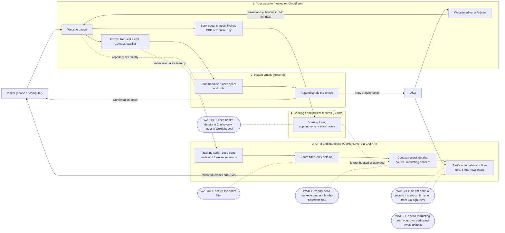

# How Alex's systems fit together

A one-page picture of what happens when someone visits the website, submits their details or books, and **which platform handles what**.

**Files**
- `docs/systems-diagram.excalidraw`: the **editable** drawing. Open <https://excalidraw.com> and use **menu > Open**, or drag the file onto the page. Every box, arrow and note is a normal Excalidraw element, so it can be moved and re-worded.
- `docs/systems-diagram.png`: a picture of the same drawing for sharing (2240 x 2490 px).
- The Mermaid version below is a plainer text-only alternative (it imports into Excalidraw but isn't as editable or readable). It can't show the "pay attention" and "what still works" panels.

**What the drawing shows:** a colour-coded grid. Each column is a platform (people, your website, instant emails, CRM and marketing, bookings and patient records) and each numbered row is one thing that happens (browsing, submitting a form in two parts, booking, Alex editing the site). Below it: six things Alex needs to pay attention to, and what still works if a platform is down. Dashed arrows are quiet background tracking, dotted arrows are planned for later.

## Plain-text version (Mermaid)

## How to read it (plain English)

**The four platforms, in one line each**
1. **Website (Cloudflare):** the public face. Pages, forms and the booking page. Alex edits it in the website editor at `/admin`.
2. **Resend:** sends the instant emails when a form is submitted: one to Alex ("new enquiry") and one to the visitor ("we got your request"). It runs quietly in the background.
3. **GoHighLevel (GATHR):** Alex's CRM. Every enquiry becomes a contact here, with where they came from and whether they agreed to marketing. Alex's automations (follow-up texts and emails, newsletters) live here.
4. **Cliniko:** the clinic system. Bookings, appointments and **all health information** live only here.

**What happens, step by step**
- **Someone browses the site:** their visit is quietly noted by GoHighLevel's tracking script (so Alex can later see which pages they looked at).
- **Someone submits a form** (Request a call, Contact, Waitlist). Two separate things happen at the same moment:
  1. The website's own form handler checks it's not spam, then Resend emails Alex and the visitor straight away. This works **even if GoHighLevel is down**.
  2. GoHighLevel's script sees the submission and creates or updates the contact, which then runs through Alex's spam filter and automations.
- **Someone books:** they choose a location on the Book page and complete the booking inside Cliniko. Nothing about the booking passes through GoHighLevel yet (a future connection could pass "booked / attended").
- **Alex changes the website:** he edits in `/admin`, saves, and the live site updates in about two minutes.

## What Alex needs to pay attention to

| # | What | Why it matters |
| --- | --- | --- |
| 1 | **Set up the spam filter in GoHighLevel** | The tracking script also sees spam submissions, so junk can land in the CRM. The website's emails are already filtered, but the CRM is not. |
| 2 | **Only send marketing to people who ticked the box** | Australian law (the Spam Act) requires consent, a clear sender and a working unsubscribe. The website records whether each person ticked. |
| 3 | **Keep health details in Cliniko only** | GoHighLevel should hold contact details, source and consent, never symptoms or treatment notes. |
| 4 | **Don't send a second instant confirmation from GoHighLevel** | The website already sends one through Resend. Build GoHighLevel automations for what happens *after* that, so people don't get two. |
| 5 | **Send marketing from Alex's own email domain** | GoHighLevel currently sends from GATHR's shared domain. Set up a dedicated sending domain before any newsletters, so emails reach inboxes. |
| 6 | **Keep the account logins in Alex's name** | Cloudflare, GitHub, Resend, Cliniko, GoHighLevel and the domain registrar should all be owned by Alex, with two-factor sign-in. |

## If one platform has a problem, what still works?

| If this is down or changes... | What still works | What is affected |
| --- | --- | --- |
| **GoHighLevel** (outage, or Alex changes CRM) | The whole website, forms, instant emails, booking | New enquiries don't reach the CRM until it's back or reconnected. Alex still gets every enquiry by email, so nothing is lost |
| **Resend** | The website, booking, and the CRM (GoHighLevel still receives the contact) | The visitor sees an error message on the form and no instant emails are sent. The visitor can try again or call/WhatsApp |
| **Cliniko** | The website, forms, emails, CRM | The booking form won't load. Visitors can call or message instead |
| **Cloudflare** (the website host) | Cliniko and GoHighLevel keep running | The website itself is unavailable |

**Why this is built this way:** the website's own emails don't depend on GoHighLevel, so the business keeps working if the CRM is down, or if Alex ever switches to a different CRM. The CRM is "added on" rather than "built in".
